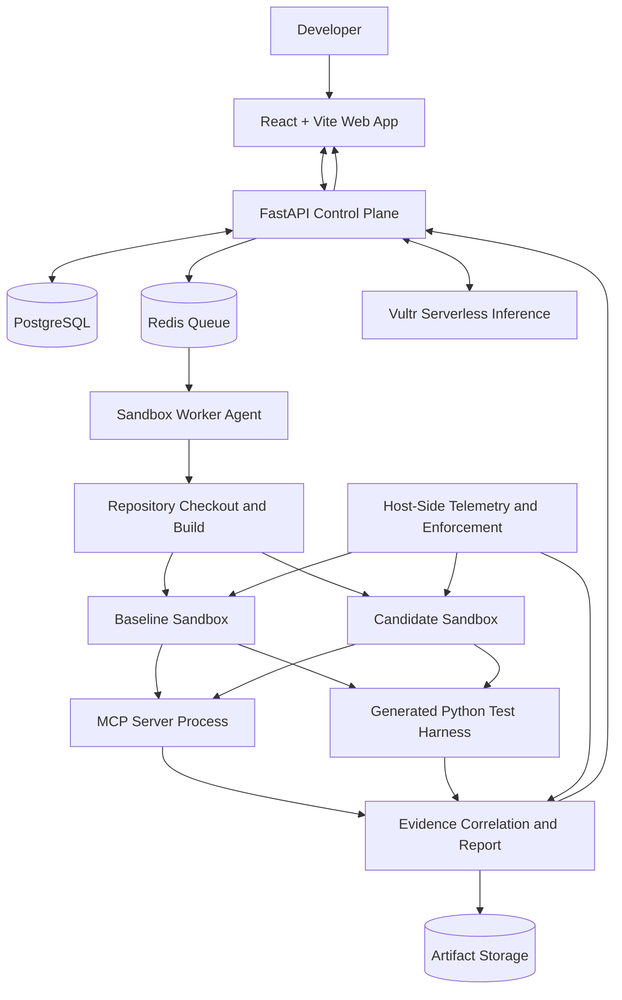
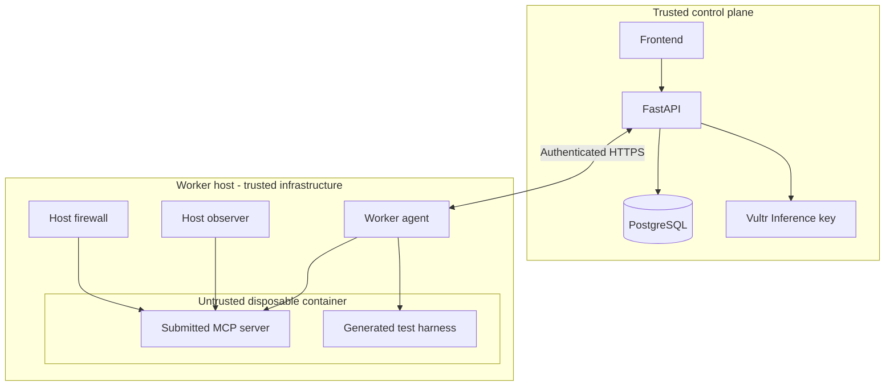

# Architecture

## Architecture principles

1. Separate trusted control plane from untrusted execution.
2. All inference requests use Vultr Serverless Inference.
3. All submitted repository code runs only in a disposable sandbox on Vultr Compute.
4. The host-side observer and network enforcement remain outside the target container.
5. Persist structured evidence and link it to test scenarios.
6. The frontend never receives infrastructure secrets.

## Logical architecture

## Deployment topology

Preferred topology:

### Control-plane VM (Vultr Compute)
Runs:
- Reverse proxy / HTTPS termination.
- React static frontend.
- FastAPI.
- PostgreSQL.
- Redis.
- Orchestrator and report services.

Holds:
- Vultr Serverless Inference API key.
- Database credentials.
- Worker authentication secret.

### Sandbox-worker VM (Vultr Compute)
Runs:
- Worker agent.
- Docker Engine.
- Host-side telemetry.
- Host firewall policy for sandbox egress.
- Temporary build and execution storage.

The worker authenticates to the control plane over HTTPS using a dedicated worker secret. The worker does not need the inference API key.

### Untrusted target container
Runs:
- Submitted MCP server.
- Generated constrained test harness, or a controlled test runner that communicates with the MCP server.
- Synthetic test data only.

It must not contain:
- Vultr API keys.
- Database credentials.
- Redis credentials.
- Worker shared secret.
- Docker socket.
- Control-plane filesystem mounts.
- Host SSH keys.

## Trust boundaries

## Data flow

1. Browser submits scan request to FastAPI.
2. FastAPI validates request and resolves repository metadata.
3. FastAPI creates scan and queue records.
4. Worker claims the job.
5. Worker fetches source and builds supported versions in isolated build environments.
6. Worker starts MCP server in a restricted runtime and discovers tools.
7. Control plane calls Vultr inference to generate a structured plan and harness.
8. Worker validates and executes the generated harness in the restricted runtime.
9. Host observer collects process, container, filesystem (if configured), and network events.
10. Worker posts events and artifacts to the control plane.
11. Evidence service correlates events with scenario and tool-call IDs.
12. Deterministic verdict engine creates the result.
13. Frontend streams progress and displays the report.

## Network design

- Public ingress should be limited to required HTTPS and administrative access.
- Worker should not expose Docker API or telemetry endpoints publicly.
- Worker should make outbound HTTPS requests to the control plane only, plus explicitly allowed build registries during the build phase.
- Target runtime containers should have default-deny egress.
- Never rely solely on a Docker network name as proof of egress denial; verify host firewall enforcement and actual connection attempts.
- Do not use host networking for target containers.

## Availability and failure handling

- Jobs must have leases or timeouts.
- Worker restarts must not cause duplicate untracked execution.
- Each scan has a terminal `COMPLETED` or `FAILED` state.
- A completed scan may have a `WARNING`, `BLOCK`, or `INCOMPLETE` verdict.
- Evidence upload failure must be visible.
- Worker loss must mark the job failed or recoverable, never passed.
